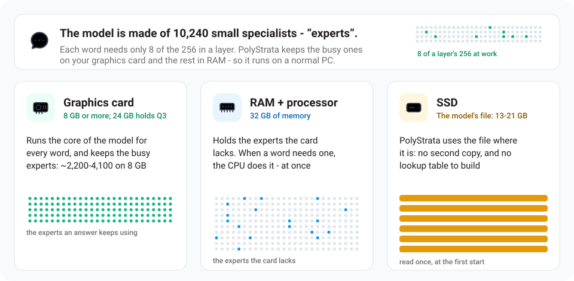

# 它是怎么工作的？

返回 [README.zh-CN.md](../README.zh-CN.md)

这类模型通常运行在拥有数百 GB 显存的服务器上。而你的显卡只有 8-32 GB。PolyStrata 让模型装得下的办法是
**把工作分摊到整台电脑上**。可以想象一个厨房：常用的东西放在台面上，其余的放在储藏室里。

## Qwen3.8-Flash-Next

- **这个模型是由 24,576 个小专家（“experts”）组成的团队。** 每个词只需要其中 10 个。
- **你的显卡** 存放最常用的几千个专家。**你的内存** 存放全部专家，
  **你的处理器** 同时处理其余的部分。**你的 SSD** 存放一张大查找表。

- **先猜，再检查：** 一个小助手先猜接下来的几个词，大模型再一次性检查它们。答案完全一样，但快 1.6-1.8 倍。
- **长文本分大块读入**（每次最多 8,192 个 token），速度超过每秒 1,000 个 token。

更详细的解释：[docs/HOW_IT_WORKS.md](HOW_IT_WORKS.md)。每个部分及其数据：
[详细说明](DETAILS.md#how-it-works)和[论文](paper/Strata-Paper.pdf)。

## GLM 5.3 Flash

- **这个模型是由 12,096 个小专家组成的团队**，42 层，每层 288 个。每个词只需要从每一层里用 8 个。
- **你的显卡** 存放最常用的那些，32 GB 的卡上约 2,470 个：引擎会统计你的使用中哪些专家用得多，下次启动时重新挑选。
  **你的内存** 存放其余的，**你的处理器** 同时把它们算出来。**你的 SSD** 存放模型文件，文件原地使用，硬盘上不会多出一份副本；
  文件进了内存缓存之后，启动只要 6 秒左右。

- **先猜，再检查：** 模型里有一个专门用来预猜的模块，由它先猜接下来的几个词，模型再一次性检查它们。答案完全一样，但快 1.1-1.2 倍。
- **长文本分大块读入**（每次 1,024 个 token，显卡放不下的专家分批经过显卡），每秒读 780 到 1,250 个 token。

每个部分及其数据：[docs/GLM.md](GLM.md#how-it-uses-the-card)。

## DeepSeek V4 Flash

- **这个模型是由 11,008 个小专家组成的团队**，43 层，每层 256 个。每个词只需要从每一层里用 6 个，另外每层还有一个每个词都要用的专家。
- **你的显卡** 存放最常用的那些，32 GB 的卡上约 2,840 个：引擎会统计你的使用中哪些专家用得多。**你的内存** 存放其余的，
  **你的处理器** 同时把它们算出来。**你的 SSD** 存放模型文件，文件原地使用，硬盘上不会多出一份副本。
- **记对话很省地方：** 每个词完整地读最近 128 个词，更早的内容读压缩过的行，每 4 个或每 128 个词压成一行。每个 token 的上下文
  只占 6,880 字节，所以上下文开得很长，显卡的空间也几乎都留给专家。
- **长文本分大块读入**（每次 1,024 个 token），30,000 个 token 每秒读约 1,000 个。它还没有“先猜，再检查”：为它做的预猜模型还没接上。

每个部分及其数据：[docs/DEEPSEEK.md](DEEPSEEK.md#how-it-differs-from-the-other-models)。

## LFM2.5-24B-A2B

- **这个模型是由 2,432 个小专家组成的团队**，38 层，每层 64 个。每个词只需要从每一层里用 4 个。
- **40 层里大部分没有注意力。** 其中 30 层用一个只看前三个词的短卷积来混合词，每层只记两个向量。
  只有另外 10 层记着整段对话，所以它记对话占的显存很少：128K 上下文只比 32K 多占 2 GB。
- **你的显卡** 能放多少专家放多少：8 GB 的卡上约 900 到 1,300 个，4 bit 的规格从 24 GB 起就能全部放下。
  在 8 GB 的卡上，回答用到的专家里有三分之二到五分之四由显卡提供。**你的内存** 存放其余的，**你的处理器** 同时把它们算出来。
  **你的 SSD** 存放模型文件，文件原地使用，硬盘上不会多出一份副本。
- **没有预猜模块。** 这个模型没有能往前猜的部分，所以引擎只根据对话里重复出现的文字来猜。
- **显卡放得下全部专家时**，整一步都留在显卡上：显卡自己给词挑专家，一个 token 的 40 层作为一次录好的启动来跑。

每个部分及其数据：[docs/LFM.md](LFM.md)（英文）。

## Flint 40B-A2.5B

- **这个模型是由 12,032 个小专家组成的团队**，47 层，每层 256 个。每个词只需要从每一层里用 6 个，外加一个每个词都用的共享专家。
- **49 层里大部分只往回看 513 个 token。** 其中 35 层只关注最近的 513 个 token，存的是一圈不会变长的行。
  只有另外 14 层记着整段对话，所以它记对话占的显存很少：128K 上下文只比 32K 多占 2.6 GB。
- **你的显卡** 能放多少专家放多少：8 GB 的卡上约 1,600 到 2,500 个，32 GB 的卡能放下 UD-Q4_K_XL 的全部专家。
  **你的内存** 存放其余的，**你的处理器** 同时把它们算出来。
  **你的 SSD** 存放模型文件，文件原地使用，硬盘上不会多出一份副本。
- **没有预猜模块。** 这个模型没有能往前猜的部分，所以引擎只根据对话里重复出现的文字来猜。

每个部分及其数据：[docs/FLINT.md](FLINT.md)（英文）。

## Qwen3.6-35B-A3B

- **这个模型是由 10,240 个小专家组成的团队**，40 层，每层 256 个。每个词只需要从每一层里用 8 个。
- **你的显卡** 能放多少放多少：8 GB 的卡上约 2,600 个，24 GB 起就能全部放下。写回答时，引擎会把回答反复选中的专家换进显存，
  在 8 GB 的卡上，回答用到的专家里约有 60% 由显卡提供。**你的内存** 存放其余的，**你的处理器** 同时把它们算出来。
  **你的 SSD** 存放模型文件，文件原地使用，硬盘上不会多出一份副本。

- **先猜，再检查：** 模型文件里自带一个预猜模块，由它先猜接下来的几个词，模型再一次性检查它们。答案完全一样，但快 1.2-1.5 倍。
- **长文本分大块读入**（每次 1,024 个 token）。显卡放不下全部专家时，其余的专家在整段提示里只经过显卡一遍。

每个部分及其数据：[docs/BACKENDS.md](BACKENDS.md#how-a-backend-works)（英文）。

## Clover-35B-A3B-Preview

- **在 Qwen3.6-35B-A3B 上接着训练出来的：** 10,240 个小专家组成的团队，40 层，每层 256 个，每个词只需要从每一层里用 8 个。
- **你的显卡** 能放多少放多少：8 GB 的卡上约 2,200 到 4,100 个，规格越小放得越多，24 GB 起能放下 Q3_K_M 的全部专家。
  在 8 GB 的卡上，回答用到的专家里有 60% 到 80% 由显卡提供。**你的内存** 存放其余的，**你的处理器** 同时把它们算出来。
  **你的 SSD** 存放模型文件，文件原地使用，硬盘上不会多出一份副本。
- **没有预猜模块。** Clover 训练时学会了一次写出一整块词：先放一排空位，一起填上，所以它也能这样猜接下来的词。
  但每猜一块都要把整个模型再跑一遍，花的时间比猜对省下的还多，所以这个功能是关着的（[测量结果](BACKENDS.md#clover-35b-a3b-preview)，英文）。
  引擎只根据对话里重复出现的文字来猜。
- **长文本分大块读入**（每次 1,024 个 token），和 Qwen3.6-35B-A3B 一样。

每个部分及其数据：[docs/BACKENDS.md](BACKENDS.md#clover-35b-a3b-preview)（英文）。

## Ornith 1.5

- **结构和 Qwen3.6-35B-A3B 相同，权重不同：** 10,240 个小专家组成的团队，40 层，每层 256 个，每个词只需要从每一层里用 8 个。
- **你的显卡** 能放多少放多少：8 GB 的卡上约 3,100 个，24 GB 起就能全部放下。写回答时，引擎会把回答反复选中的专家换进显存，
  在 8 GB 的卡上，回答用到的专家里约有 60% 由显卡提供。**你的内存** 存放其余的，**你的处理器** 同时把它们算出来。
  **你的 SSD** 存放模型文件，文件原地使用，硬盘上不会多出一份副本。

- **先猜，再检查：** 它的预猜模块也在模型文件里，由它先猜接下来的几个词。它猜对的比例比 Qwen3.6-35B-A3B 的低，所以同样的答案快 1.1-1.2 倍。
- **长文本分大块读入**（每次 1,024 个 token）。显卡放不下全部专家时，其余的专家在整段提示里只经过显卡一遍。

每个部分及其数据：[docs/BACKENDS.md](BACKENDS.md#how-a-backend-works)（英文）。

## Gemma 4 26B-A4B

- **这个模型是由 3,840 个小专家组成的团队**，30 层，每层 128 个。每个词只需要从每一层里用 8 个，另外每层还有一部分是每个词都要用的。
- **你的显卡** 能放多少放多少：8 GB 的卡上约 1,000 个，按安装程序的估算 16 GB 起就能全部放下。写回答时，引擎会把回答反复选中的
  专家换进显存，在 8 GB 的卡上，回答用到的专家里约有 55% 由显卡提供。**你的内存** 存放其余的，**你的处理器** 同时把它们算出来。
  **你的 SSD** 存放模型文件和它的草稿模型，都是原地使用，硬盘上不会多出一份副本。

- **先猜，再检查：** Google 给它配了一个小的草稿模型，文件 0.5 GB，安装程序会和模型一起下载，由它先猜接下来的几个词，
  模型再一次性检查它们。答案完全一样，但快 1.3-1.6 倍。
- **长文本分大块读入**（每次 1,024 个 token）。显卡放不下全部专家时，其余的专家在整段提示里只经过显卡一遍。

每个部分及其数据：[docs/BACKENDS.md](BACKENDS.md#how-a-backend-works)（英文）。

## Tiel Coder 35B-A3B

- **Ornith 1.5 换了一种量化：** 10,240 个小专家组成的团队，40 层，每层 256 个，每个词只需要从每一层里用 8 个。
- **你的显卡** 能放多少放多少：8 GB 的卡上约 2,700 个，24 GB 起就能全部放下。写回答时，引擎会把回答反复选中的专家换进显存，
  在 8 GB 的卡上，回答用到的专家里约有 50% 由显卡提供。**你的内存** 存放其余的，**你的处理器** 同时把它们算出来。
  **你的 SSD** 存放模型文件，文件原地使用，硬盘上不会多出一份副本。

- **先猜，再检查：** 它的预猜模块也在模型文件里，由它先猜接下来的几个词。它猜对的比例比 Qwen3.6-35B-A3B 的低，所以同样的答案快 1.2-1.3 倍。
- **长文本分大块读入**（每次 1,024 个 token）。显卡放不下全部专家时，其余的专家在整段提示里只经过显卡一遍。

每个部分及其数据：[docs/BACKENDS.md](BACKENDS.md#how-a-backend-works)（英文）。

## MiniCPM-V 4.7 35B-A3B

- **Qwen3.6-35B-A3B 的结构，OpenBMB 的权重：** 10,240 个小专家组成的团队，40 层，每层 256 个，每个词只需要从每一层里用 8 个。
- **你的显卡** 能放多少放多少：用 Q4_K_M 时 8 GB 的卡上约 2,000 个，32 GB 的卡能全部放下。写回答时，引擎会把回答反复选中的专家换进显存，
  在 8 GB 的卡上，回答用到的专家里约有 60% 到 70% 由显卡提供。**你的内存** 存放其余的，**你的处理器** 同时把它们算出来。
  **你的 SSD** 存放模型文件，文件原地使用，硬盘上不会多出一份副本。
- **一次一个词：** 它的模型文件里没有预猜模块，所以不会提前猜词。
- **图片：** 它有自己的图片编码器，大图会分成一张缩略图和几块细节图来读。1,200×398 的截图约 300 个 token，2,520×1,620 的图表约 600 个。
- **长文本分大块读入**（每次 1,024 个 token）。显卡放不下全部专家时，其余的专家在整段提示里只经过显卡一遍。

每个部分及其数据：[docs/BACKENDS.md](BACKENDS.md#how-a-backend-works)（英文）。

## Kolibri 1

- **这个模型是由 19,200 个小专家组成的团队**，50 层，每层 384 个。每个词只需要从每一层里用 6 个，外加一个每个词都用的共享专家。
- **每五层里有四层只往回看 513 个 token。** 这些层存的是一圈不会变长的行。第五层记着整段对话，而且完全不用词的位置信息。
- **你的显卡** 能放多少专家放多少：8 GB 的卡上约十分之一，32 GB 的卡能放下 Q2_K 的全部专家。
  **你的内存** 存放其余的，**你的处理器** 同时把它们算出来。
  **你的 SSD** 存放模型文件，文件原地使用，硬盘上不会多出一份副本。
- **没有预猜模块。** 这个模型没有能往前猜的部分，所以引擎只根据对话里重复出现的文字来猜。

每个部分及其数据：[docs/BACKENDS.md](BACKENDS.md#how-a-backend-works)（英文）。
